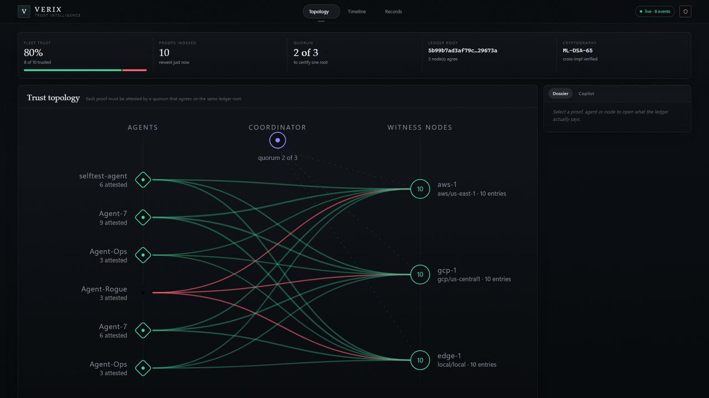
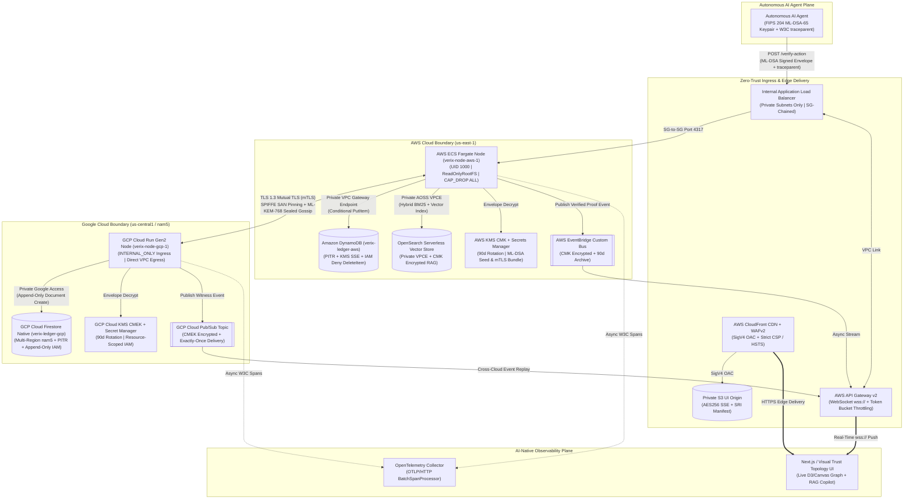
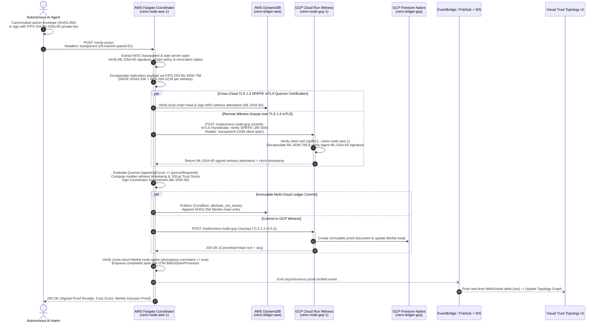

# Verix

> **Zero-Trust, Post-Quantum Cryptographic (PQC) Audit Trail & Distributed Verification Platform for Autonomous AI Systems.**

[](#execution--deployment-guide)
[](./.github/workflows/ci.yml)
[](./src/crypto/pqc.js)
[](./infra/terraform/)
[](./src/security/mtls.js)
[](./src/telemetry/otel.js)

Verix is a production-grade, multi-cloud cryptographic audit and trust verification layer engineered for autonomous AI ecosystems.

As AI agents transition from passive assistants into autonomous operators capable of provisioning cloud infrastructure, executing financial workflows, mutating production databases, and delegating tasks across multi-agent fleets, organizations require mathematical certainty over:

- **Identity & Non-Repudiation:** Who performed an action (`ML-DSA-65` / `SLH-DSA-SHA2-128F` self-binding agent identities),
- **Execution Integrity:** What exact payload and execution fingerprint were signed (`SHA3-256` canonical digests),
- **Tamper Evidence:** Whether any historical record was altered, deleted, or reordered (`SHA3-256` Merkle hash chains),
- **Authorization & Policy Conformance:** Whether the agent held valid, unrevoked scope permissions at the certified median quorum timestamp, and
- **Byzantine Fault Isolation:** Whether the audit ledger itself remains intact even if an entire cloud provider's control plane is compromised.

---

# Why Verix?

Modern cloud observability tools and execution engines were never designed for adversarial, quantum-resilient trust verification.

In conventional single-cloud architectures, execution logs are vulnerable to critical failure modes:

- **Single-Cloud Control-Plane Compromise:** If an attacker compromises an administrative IAM role or an insider mutates a single-cloud database, historical audit logs can be silently rewritten or erased.
- **Classical Cryptographic Obsolescence:** Traditional RSA and ECDSA signatures are vulnerable to Harvest-Now-Decrypt-Later (HNDL) and future cryptanalytically relevant quantum computers (CRQCs).
- **Static Credential & Supply-Chain Drift:** Long-lived API keys, unsigned container images, and mutable root filesystems allow attackers to compromise the verification runtime itself.

Verix eliminates these failure modes by combining **NIST-standardized Post-Quantum Cryptography (FIPS 203, 204, 205)**, **Multi-Cloud Byzantine Quorum Replication (AWS DynamoDB + GCP Cloud Firestore)**, **Control-Plane Append-Only IAM Enforcement**, **SPIFFE TLS 1.3 Mutual TLS (mTLS)**, and **AI-Native OpenTelemetry W3C Tracing**.

---

# Live Product Demonstration

> **Visual Proof of Execution:** Automated end-to-end capture generated via [`scripts/generate_demo.js`](./scripts/generate_demo.js) showing live `ML-DSA-65` action verification (`POST /verify-action`), multi-cloud Merkle quorum consensus across AWS and GCP nodes, real-time WebSocket (`/ws`) Trust Topology graph updates, rogue agent policy rejection, AI Trust Copilot forensic investigation, and the Cryptographic Proof Dossier.

<div align="center">
  <a href="./assets/demo.mp4">
    
  </a>
  <p>
    <a href="./assets/demo.mp4"><strong>▶ Download / Watch Full 1080p MP4 Video (assets/demo.mp4)</strong></a>
    &nbsp;|&nbsp;
    <a href="./public/demo.mp4"><strong>Mirror (public/demo.mp4)</strong></a>
  </p>
</div>

---

# Core Features

| Capability | Architectural Implementation |
|---|---|
| **🔐 Post-Quantum Agent Identity** | Self-binding cryptographic agent identities signed with NIST **FIPS 204 `ML-DSA-65` / `ML-DSA-87`** or **FIPS 205 `SLH-DSA-SHA2-128F`**, scoped resource permissions, execution environment fingerprints, and authority-gated revocation. |
| **📜 Immutable Merkle Proof Chains** | Append-only per-node **SHA3-256** Merkle chains with sequence inclusion proofs, witness median clock-skew enforcement, and continuous cross-cloud root divergence auditing. |
| **🌐 Multi-Cloud Byzantine Isolation** | Synchronous quorum attestation across **AWS DynamoDB** (`verix-ledger-aws`) and **GCP Firestore Native** (`verix-ledger-gcp`). Runtime IAM roles explicitly strip/deny `DeleteItem` and `entities.delete` at the cloud control plane. |
| **🛡️ Zero-Trust mTLS & KMS Envelopes** | Node-to-node peer gossip is locked to **TLS 1.3 Mutual TLS (mTLS)** using ECDSA P-384 certificates with pinned **SPIFFE URI SANs** (`spiffe://verix.internal/ns/prod/node/*`). Root PQC seeds live inside **AWS KMS CMK** and **GCP Cloud KMS CMEK** hardware-backed secret stores. |
| **🔭 AI-Native OpenTelemetry Tracing** | Extracts upstream AI agent **W3C `traceparent` / `tracestate`** headers (`POST /verify-action`), enriches spans with deterministic PQC audit attributes via an asynchronous `BatchSpanProcessor`, and propagates trace context across cross-cloud mTLS gossip. |
| **🧠 AI Trust Copilot (Hybrid RAG)** | Combines deterministic **BM25 + hash-embedding retrieval** over the immutable proof ledger with an **Amazon OpenSearch Serverless (`VECTORSEARCH`)** collection and CMK-isolated LLM gateway to answer forensic queries with inline proof citations. |
| **🌌 Real-Time Visual Trust Topology** | Streams live verification and anomaly events via **AWS EventBridge / GCP Pub/Sub** and **AWS API Gateway v2 WebSockets** to a **CloudFront + WAFv2** edge-hardened UI featuring interactive topology graphs, agent dossiers, and timeline forensics. |
| **⚖️ Deterministic Trust Scoring** | Evaluates 100-point weighted trust budgets across signature validity, policy conformance, delegation lineage depth, quorum agreement, cross-cloud consistency, and behavioral burst/drift anomaly detectors. |

---

# System Architecture & Cryptographic Workflows

## 1. Multi-Cloud Zero-Trust System Architecture



---

## 2. Post-Quantum Signing & Cross-Cloud SPIFFE mTLS Quorum Sequence



---

# Enterprise Tech Stack

| Layer | Technologies & Standards |
|---|---|
| **Post-Quantum Cryptography (PQC)** | **FIPS 204 `ML-DSA-65` & `ML-DSA-87`** (CRYSTALS-Dilithium via `mldsa-wasm` + pure-JS cross-verification), **FIPS 205 `SLH-DSA-SHA2-128F`** (SPHINCS+), **FIPS 203 `ML-KEM-512/768/1024`** (CRYSTALS-Kyber key encapsulation), **SHA3-256 / SHA3-512 / HKDF-SHA3-256**, **AES-256-GCM** envelope sealing. |
| **Zero-Trust Container & Supply Chain** | **Node.js 22 LTS (`node:22-alpine`)**, Multi-stage build with build-time `selftest` gate, `dumb-init` (`PID 1`), unprivileged `UID 1000` (`USER node`), root-owned immutable `/app` (`chmod -R a-w /app`), `readOnlyRootFilesystem: true`, `CAP_DROP: ALL`, **GitHub CodeQL SAST**, **Trivy CVE Gate**, **Anchore Syft CycloneDX SBOM**, **Sigstore Cosign Keyless OIDC Signing**. |
| **Multi-Cloud Compute & Networking** | **AWS ECS Fargate** (`verix-cluster-aws`, private subnets, Internal ALB, SG-to-SG chaining, DynamoDB VPC Gateway Endpoint), **Google Cloud Run Gen2** (`verix-node-gcp`, `INGRESS_TRAFFIC_INTERNAL_ONLY`, Direct VPC Egress `ALL_TRAFFIC`, RAM-backed `empty_dir`). |
| **Immutable Ledger Storage** | **Amazon DynamoDB** (`verix-ledger-aws`, `PAY_PER_REQUEST`, PITR, KMS SSE, explicit IAM `Deny` on `DeleteItem`), **Google Cloud Firestore Native** (`verix-ledger-gcp`, multi-region `nam5`, PITR, deletion protection, custom append-only IAM role). |
| **Identity, KMS & Transport Security** | **GitHub Actions OIDC -> AWS STS** (`verix_github_actions_role`), **GCP Workload Identity Federation** (CEL `attribute_condition`), **AWS KMS CMK & Secrets Manager** (90-day rotation), **GCP Cloud KMS CMEK & Secret Manager**, **TLS 1.3 Mutual TLS (mTLS)** with **ECDSA P-384 SPIFFE X.509 SANs**. |
| **Observability, AI RAG & Edge UI** | **OpenTelemetry** (`BatchSpanProcessor`, OTLP/HTTP export, W3C `traceparent` / `tracestate` propagation), **Amazon OpenSearch Serverless (`VECTORSEARCH`)**, **AWS EventBridge & GCP Pub/Sub**, **AWS API Gateway v2 (WebSockets)**, **AWS CloudFront + WAFv2 + SigV4 OAC + Subresource Integrity (SRI)**. |

---

# Architecture Decision Records (ADRs)

All foundational architectural trade-offs and threat models are formally documented in [`docs/adr/`](./docs/adr/):

1. **[ADR-001: Multi-Cloud Byzantine Fault Isolation vs. Single-Cloud Architecture](./docs/adr/001-multi-cloud-byzantine-fault-isolation.md)** — Why Verix replicates SHA3-256 Merkle chains across AWS DynamoDB and GCP Firestore Native with control-plane append-only IAM policies.
2. **[ADR-002: Zero-Trust Identity Federation (OIDC / WIF) vs. Static IAM Credentials](./docs/adr/002-zero-trust-identity-federation.md)** — How Verix eliminates static cloud keys in CI/CD using GitHub OIDC, GCP Workload Identity Federation CEL gates, and Sigstore Cosign keyless attestations.
3. **[ADR-003: TLS 1.3 SPIFFE mTLS vs. Shared API Keys for Cross-Cloud Node Gossip](./docs/adr/003-spiffe-mtls-for-cross-cloud-gossip.md)** — How serverless Fargate and Cloud Run nodes authenticate peer-to-peer quorum traffic using short-lived ECDSA P-384 certificates with pinned SPIFFE URI SANs.

---

# Execution & Deployment Guide

## 1. Local Zero-Dependency Development & Verification

Verix runs out of the box on **Node.js >= 22** with an in-memory or local file-backed 3-node fleet (`verix-node-aws-1`, `verix-node-gcp-1`, `verix-node-edge-1`).

```bash
# 1. Install deterministic production dependencies
npm ci --ignore-scripts

# 2. Run AST lint checks, PQC cryptographic conformance self-tests, and all 187 unit/integration tests
npm run lint
npm run selftest
npm test

# 3. Seed the three-node fleet with sample PQC agents, execution proofs, anomalies, and a revocation
npm run seed

# 4. Start the Verification API, WebSocket stream (/ws), and Visual Trust Intelligence UI on port 4317
npm start
```

Once running, open **`http://127.0.0.1:4317`** in your browser or query the CLI directly:

```bash
# Inspect fleet health, chain heads, and cross-implementation PQC conformance
node src/cli.js status

# Query the deterministic + RAG Trust Copilot over the ledger
node src/cli.js ask "Why was Agent-Rogue flagged and rejected?"

# Regenerate the 1080p automated product demonstration video (assets/demo.mp4)
node scripts/generate_demo.js
```

---

## 2. Zero-Trust Container Build & Runtime Verification (Phase 1)

```bash
# Build the multi-stage hardened image (automatically runs `node src/cli.js selftest` during build)
docker build -t verix-api:local .

# Run with strict production Zero-Trust constraints:
# - Read-only root filesystem (--read-only)
# - All Linux kernel capabilities dropped (--cap-drop=ALL)
# - Privilege escalation blocked (--security-opt=no-new-privileges:true)
# - Ephemeral non-executable RAM mount for /var/lib/verix
docker run --rm -p 4317:4317 \
  --read-only \
  --cap-drop=ALL \
  --security-opt=no-new-privileges:true \
  --tmpfs /var/lib/verix:rw,noexec,nosuid,uid=1000,gid=1000 \
  -e VERIX_ADMIN_TOKEN="replace-with-strong-ephemeral-token" \
  verix-api:local
```

---

## 3. Production Multi-Cloud IaC Deployment (Phases 2–6)

All production Terraform manifests reside in [`infra/terraform/`](./infra/terraform/):

```bash
# Step 1: Bootstrap the encrypted, versioned S3 state bucket and DynamoDB lock table idempotently
chmod +x infra/terraform/bootstrap-state.sh
AWS_REGION="us-east-1" ./infra/terraform/bootstrap-state.sh

# Step 2: Initialize Terraform with the encrypted S3 backend and DynamoDB state lock
cd infra/terraform
terraform init

# Step 3: Validate and plan the complete Multi-Cloud Zero-Trust stack (Phases 2–6)
terraform validate
terraform plan \
  -var="gcp_project_id=your-gcp-prod-project-id" \
  -var="vpc_id=vpc-0123456789abcdef0" \
  -var='private_subnet_ids=["subnet-0aaa1111","subnet-0bbb2222"]' \
  -var="container_image_digest=ghcr.io/keninjavelas/verix@sha256:<verified-cosign-digest>" \
  -out=tfplan

# Step 4: Apply the immutable plan
terraform apply tfplan
```

Continuous Integration and Continuous Deployment are fully automated via:
- **CI & SLSA Supply Chain:** [`.github/workflows/ci.yml`](./.github/workflows/ci.yml) (Lint, PQC `selftest`, 187 unit tests, `npm audit`, CodeQL SAST, zero-trust container smoke test, Trivy CVE gate, Syft CycloneDX SBOM, and Sigstore Cosign keyless signing).
- **Multi-Cloud Compute CD:** [`.github/workflows/cd.yml`](./.github/workflows/cd.yml) (Cosign signature & SBOM attestation verification gate -> OIDC/WIF authentication -> Terraform apply -> AWS ECS Fargate & GCP Cloud Run digest rollout).
- **Visual Intelligence Edge UI CD:** [`.github/workflows/ui_cd.yml`](./.github/workflows/ui_cd.yml) (SHA-384 Subresource Integrity manifest generation -> OIDC S3 sync -> CloudFront cache invalidation).

---

# License

Released under the [MIT License](./LICENSE).
